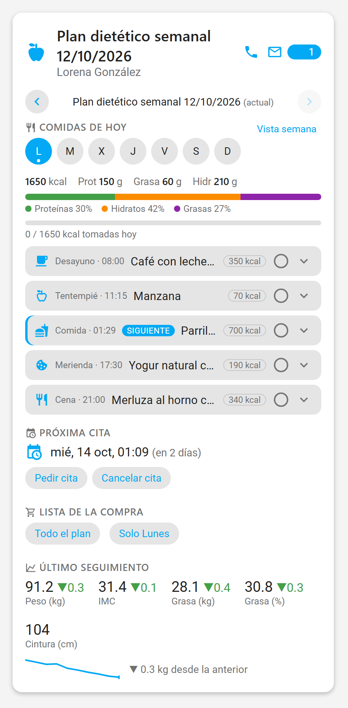
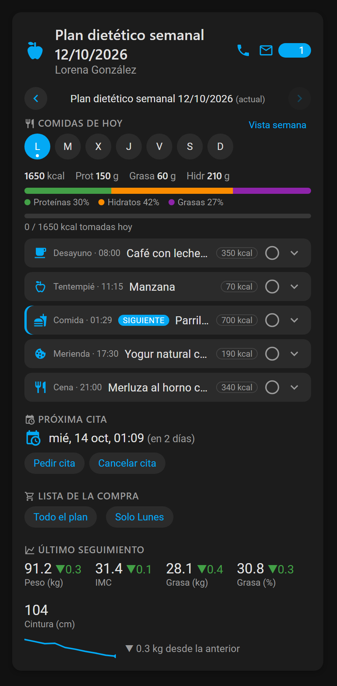
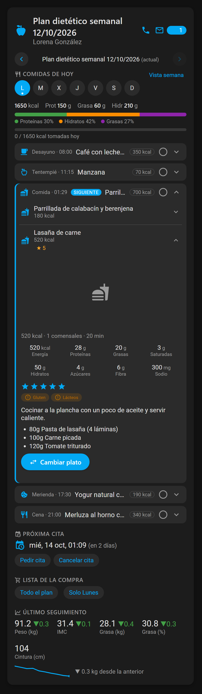
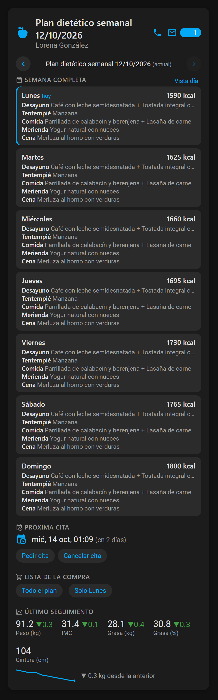

# Nutriplan Bridge for Home Assistant

Integración personalizada de Home Assistant (`custom_components/nutriplan_bridge`)
para una app de pacientes de nutrición, con sensores de **plan/comidas del
día** y **próxima cita/seguimientos**, más una tarjeta Lovelace
(`nutriplan-bridge-card`) que se registra sola, sin tocar `resources:` a mano.


<p align="center">
  
  
</p>
<p align="center">
  
  
</p>

## Cómo se obtuvo el contrato de la API

No es una integración "a ciegas". La app oficial es React Native + Expo
compilada a bytecode Hermes (`assets/index.android.bundle`). Se decompiló ese
bytecode con [hermes-dec](https://github.com/P1sec/hermes-dec) y se leyó
directamente la definición de la API (RTK Query) del código fuente de la app:
rutas, verbos HTTP, y los nombres de campo exactos de las respuestas
(`sentByEmailAt`, `nombreHorario`, `pesoGrasa`, etc.). Esto se cruzó además
en vivo contra el backend (solo códigos de estado HTTP, sin usar ninguna
cuenta) para confirmar qué rutas existen y qué verbo aceptan.

**Verificado por código fuente + en vivo:**
- `POST /api/login_check` — FormData `_username` / `_password`
- `GET /api/paciente/plans` — lista de planes (`id`, `created`, `sentByEmailAt`, `title`)
- `GET /api/paciente/plan[?id=]` — detalle de un plan, con `dietas: [...]`
- `GET /api/paciente/cita` — `{"cita": {...} | null}`
- `GET /api/paciente/seguimientos` — lista con `peso`, `imc`, `pesoGrasa`, `porcentajeGrasa`, `pesoMasaMagra`, `pesoAgua`, `perimetroCintura`, `perimetroCinturaUmbilical`, `perimetroCadera`, `createdTimestamp`
- `GET /api/paciente/dietista`
- `GET /api/paciente/current-user` — perfil del propio paciente
- `GET /api/paciente/eni` — estado de la encuesta nutricional inicial
- `GET /api/paciente/rating` — valoraciones que el paciente ha dado
- `GET /api/paciente/charla` — charlas/consultas con el dietista
- `GET /api/paciente/chat/unread` y `/chat/messages` — chat con el dietista
- `PUT /api/paciente/chat/reset-unread` — marcar el chat como leído
- `PUT /api/paciente/superplato/{id}/rating` — valorar un plato

`api/paciente/pagos` se intuía por el nombre del hook `useGetPagosQuery` pero
**no existe** (probado en vivo: 404), así que no hay nada de pagos en la
integración.

Cada franja de una `dieta` (p. ej. `dieta.comida`) trae a su vez `hora` y una
lista `subingestas` (una comida puede tener más de un plato, p. ej. desayuno
= café + sándwich). Cada `subingesta.plato` trae `alimentoCantidades`
(ingredientes: `alimento.nombre`, `cantidad`, `medidaCasera`, más el grupo y
supergrupo del alimento), datos nutricionales completos (energía, proteínas,
grasas, carbohidratos, fibra, sodio, potasio, calcio, hierro, vitaminas...),
`alergenos`, y `superPlato` (`nombre`, `receta` -puede ser `null` en platos
simples como una pieza de fruta-, `comensales`, `duracion`, `rating`,
`imagePath`/`thumbnail`). Esto está confirmado contra una respuesta real de
la API (no solo inferido del código de la app). El sensor `comidas_hoy`
expone todo esto ya montado por plato en su atributo `comidas` (incluido un
diccionario `nutrientes` por plato, y los identificadores `subingesta_id`/
`plato_id`/`super_plato_id` que hacen falta para las acciones de cambiar o
valorar un plato), y además un `resumen_nutricional` con el total del día
(suma de todos los platos), y `plan_id`/`dieta_index` para las mismas
acciones. La tarjeta lo muestra desplegable con receta, alérgenos, calorías
e ingredientes por cada plato.

El sensor `seguimientos` incluye además un `historial` completo (no solo el
último registro) y `delta_peso`/`delta_imc`/`delta_peso_grasa`/`delta_porcentaje_grasa`
respecto a la medición anterior. El campo real de agua corporal es
`porcentajeAgua` (no `pesoAgua` como sugería el código decompilado); cuando
la cuenta no manda directamente `pesoAgua`/`pesoMasaMagra`, se calculan
(`peso_agua = peso * porcentajeAgua / 100`, `peso_masa_magra = peso - peso_grasa`).

El sensor `estado_eni` no es solo "% completado": es la ficha completa de la
encuesta inicial (objetivo, antropometría, alergias/intolerancias/aversiones,
fármacos, hábitos de vida, y los objetivos de energía/macros que DietoPro
calculó a partir de ella, incluida una `ingesta_diaria_recomendada` con el
mismo formato que los `nutrientes` de cada plato). Se completa cuando
`lastViewedStep` llega a `"eniFinish"` (los flags booleanos que se habían
intuido al principio no existen).

**Único punto sin confirmar al 100%:** el nombre exacto del campo de fecha
*dentro* del objeto `cita` (no había forma de verlo sin una respuesta real
autenticada). El sensor de "Próxima cita" prueba varios nombres candidatos y,
si ninguno encaja, sigue funcionando (indica "programada" en vez de la fecha)
y expone el JSON completo en el atributo `raw` para ajustarlo en un minuto si
hace falta.

## Instalación

**Con HACS (recomendado):** HACS → Integraciones → ⋮ → *Repositorios
personalizados* → pega `https://github.com/MUbeira0/nutriplan-bridge` con
categoría *Integración* → Descargar → reinicia Home Assistant.

**A mano:**

1. Copia la carpeta `custom_components/nutriplan_bridge` de este repo a
   `<config>/custom_components/nutriplan_bridge` de tu instalación de Home
   Assistant.
2. Reinicia Home Assistant.
3. Ajustes → Dispositivos y servicios → Añadir integración → **Nutriplan
   Bridge**.
4. Introduce tu email y contraseña de la app (viajan directamente al backend
   real, nunca pasan por ningún otro sitio).

Esto crea 10 entidades bajo un dispositivo "Nutriplan Bridge":
`sensor.nutriplan_bridge_plan_actual`, `sensor.nutriplan_bridge_comidas_hoy`,
`sensor.nutriplan_bridge_proxima_cita`, `sensor.nutriplan_bridge_seguimientos`,
`sensor.nutriplan_bridge_dietista`, `sensor.nutriplan_bridge_mensajes_sin_leer`,
`sensor.nutriplan_bridge_mi_perfil`, `sensor.nutriplan_bridge_estado_eni`,
`sensor.nutriplan_bridge_valoraciones`, `sensor.nutriplan_bridge_charlas`.

Y estas acciones (Herramientas de desarrollo → Acciones, o en automatizaciones):
- `nutriplan_bridge.obtener_comidas` (solo lectura: todos los días de un plan,
  el actual o uno anterior pasando `plan_id`, con comidas y resumen
  nutricional de cada día; es lo que usa la tarjeta para navegar)
- `nutriplan_bridge.lista_compra` (suma los ingredientes de un plan, o de los
  días que indiques, agrupados por categoría; con `todo_entity` los añade a
  una lista de Home Assistant, p. ej. `todo.shopping_list`)
- `nutriplan_bridge.marcar_chat_leido`
- `nutriplan_bridge.valorar_plato` (necesita el `super_plato_id` que trae
  cada plato en el atributo `comidas` del sensor `comidas_hoy`, y una
  puntuación de 1 a 5)
- `nutriplan_bridge.opciones_plato` (solo lectura: lista los platos
  alternativos para sustituir uno en una franja, usando `plato_id` + `franja`
  del atributo `comidas`)
- `nutriplan_bridge.cambiar_plato` — **modifica tu plan real, no es
  reversible desde HA**. Necesita `plan_id`, `dieta` (el `dieta_index` del
  sensor `comidas_hoy` — es el día de la semana, 0=lunes, deducido de la
  propia llamada a esta acción en la app), `franja`, `plato_actual_id` (el
  `plato_id` del plato a sustituir, no su `subingesta_id`) y
  `nuevo_plato_id` (de `opciones_plato`).

  **Historial:** la primera versión daba un 500 real (error interno del
  servidor de DietoPro) al probarla en vivo, y tras corregir eso pasó a
  "funcionar" sin error pero sin cambiar nunca el plato de verdad (ni en
  Home Assistant ni en la app oficial). Las dos causas, encontradas
  retrocediendo otra vez sobre el código de la mutación:
  1. La app convierte `planId`/`dieta` a número explícitamente pero manda
     `currentId` tal cual - se asumió que `currentId` era el `subingesta_id`
     (texto, tipo `"14256879280"`), corregido para que viajara como texto.
  2. **Ese supuesto era incorrecto de raíz**: rastreando el punto exacto
     donde la app arma la llamada (dos sitios distintos en el código
     decompilado, `ChangePlatoOptionsContainer` y
     `ChangePlatoPreviewModal`, coinciden) se ve que `currentId` en
     realidad **nunca** es el `subingesta_id` — es el propio `plato_id`
     (número) del plato que se está sustituyendo, el mismo identificador
     que ya se usa para pedir alternativas en `opciones_plato`. Al mandar
     el `subingesta_id`, DietoPro no encontraba ningún plato que
     coincidiera y simplemente no hacía nada, sin dar ningún error. Ya
     corregido: el campo se llama `plato_actual_id` y espera el `plato_id`,
     no el `subingesta_id`.

  También se vio en vivo que alguna opción venía sin `id` utilizable, lo
  que rompía la validación con un error críptico ("expected int...").
  Corregido (opciones sin id descartadas, y validación propia con mensajes
  claros en vez de dejar que falle la validación en bruto). Si te sigue
  fallando, prueba el mismo cambio desde la app oficial: si allí también
  falla, no es cosa de esta integración.
  Los errores salen cortos en la tarjeta; el detalle técnico completo
  queda en el registro de Home Assistant (Ajustes → Sistema → Registros).

## Novedades 0.31

Contratos sacados de la app oficial v51. **Estas acciones escriben en tu cuenta
real** y no se han podido probar contra una; compruébalas la primera vez en la
app oficial.

- **Registrar medición (opcional y manual).** En DietoPro es tu dietista quien
  *abre* una medición y tú la rellenas por pasos; esta integración no puede
  crearla. Acciones: `medicion_abierta` (solo lectura: ¿hay una abierta?) y
  `registrar_medicion` (peso, % grasa, % agua, % masa magra y perímetros de
  cintura, cadera, pecho, pierna y brazo; `finalizar` la cierra, por defecto sí).
  No hay ninguna automatización ni sincronización con básculas: solo se envía
  cuando tú la llamas. En la tarjeta el botón **no aparece** salvo que actives
  `show_measurement` en su editor; pide confirmación antes de enviar.
- **Fotos y documentos al chat.** Acción `enviar_archivo_chat` (ruta de un
  archivo de la máquina de Home Assistant, máx. 15 MB; solo rutas permitidas
  como `/config` o `/media`) y botón **Adjuntar foto o documento** en el panel
  de mensajes de la tarjeta (solo administradores).

## Novedades 0.30

- **Comidas tomadas, compartidas entre dispositivos.** Antes las marcas se
  guardaban solo en cada navegador. Ahora viven en Home Assistant (nuevo sensor
  *Comidas tomadas hoy* y acción `marcar_comida`): lo que marcas en el móvil
  lo ves en el PC. El sensor calcula también el **cumplimiento de la semana**
  (comidas tomadas / planificadas) y un historial de 14 días. No se envía
  nada a DietoPro. Si el sensor no existe, la tarjeta sigue usando el
  almacenamiento local.
- **Avisos en Ajustes → Reparaciones:** "DietoPro no responde" tras 3
  actualizaciones seguidas sin datos, y "el plan tiene un formato inesperado"
  (por si DietoPro cambia su API). Se borran solos al recuperarse.
- **Contraseña caducada:** ahora abre el flujo de reautenticación de Home
  Assistant en vez de dejar la integración simplemente fallando.
- **Calorías de alimentos sueltos estimadas** a partir de su composición (por
  100 g) y la cantidad; se muestran con "~". Si la API envía las calorías
  reales, se usan esas. El diagnóstico incluye los valores para poder
  comprobarlo.
- Las consultas a DietoPro se mantienen como estaban (todas las fuentes en cada
  actualización) para que cualquier cambio hecho en la app oficial se vea.

## Novedades 0.29

- **Alimentos sueltos** (p. ej. "Pollo, pechuga, solomillo (130 g)"): ahora se
  pueden cambiar por un equivalente desde la tarjeta ("Cambiar alimento") o con
  las acciones `opciones_alimento` (solo lectura) y `cambiar_alimento`
  (**modifica tu plan real**). Contratos sacados de la app oficial v51:
  `GET alimentos?change=&quantity=` y `PATCH changes/{plan}/alimento`.
  Sin probar contra una cuenta real: la primera vez, comprueba el resultado en
  la app oficial.
- Los alimentos sueltos ya no muestran el hueco grande de imagen ni "No
  requiere preparación".
- `opciones_plato` con un ID vacío devuelve un mensaje claro en lugar de un
  error 500 de DietoPro.
- **La tarjeta se sirve desde una URL con la versión** (`/nutriplan_bridge_files/v0.29.0/...`),
  así el navegador o la app de Home Assistant nunca reutilizan una copia
  antigua en caché tras actualizar.

## Novedades 0.28 (ajustadas con datos de una cuenta real)

Un diagnóstico descargado de una cuenta real confirmó la forma de varios
datos que antes eran suposiciones: la cita (`fecha`, `duracion`, confirmaciones
y permisos de la cuenta), las charlas y los objetivos por día de la encuesta
inicial. Con eso:

- **La tarjeta solo ofrece lo que tu cuenta permite:** "Pedir cita" solo si la
  reserva está habilitada, "Cancelar" solo si la cancelación no está
  deshabilitada y "Confirmar" solo si tu cuenta exige confirmar. Ya no salen
  botones que darían error.
- **Cita:** duración real (15 min en el calendario) y estado ("confirmada por
  tu dietista", "falta tu confirmación"...). Nuevo binary sensor *Cita sin
  confirmar*.
- **Charlas** en la tarjeta (tema, fecha, enlace, punto de "sin ver") y el
  atributo `sin_ver` en el sensor.
- **Objetivos de la encuesta inicial** junto a las calorías y macros del día.
- El plan vigente se elige correctamente (comprobado con el diagnóstico real).

## Novedades 0.27

- **Imagen de marca:** icono y logo (claro/oscuro) en `brand/`.
- **Iconos de acciones** (`icons.json`) y **iconos que cambian con el estado**:
  la próxima comida (café, comida, cena...), la variación de peso (↘/↗), el chat
  y los binary sensors (campana, mensaje, calendario...).
- **Tarjeta:** accesible con teclado (Tab, Enter/Espacio) y lectores de
  pantalla, tamaño y redimensionado en las vistas por secciones, vista previa
  en el selector de tarjetas, alérgenos como etiquetas con icono, calorías por
  comida, valoración en cada plato, estados vacíos/de carga con icono, modo
  compacto y color de acento.

## Novedades 0.26 (rastreadas en la app oficial v51.0.0)

Contratos sacados del bundle decompilado de la app (no inventados):

- `nutriplan_bridge.enviar_mensaje` (`texto`): escribe al dietista
  (`POST chat/messages {text}`).
- `nutriplan_bridge.citas_disponibles` (`desde`, `hasta`): solo lectura, huecos
  libres (`GET citas/available-slots?from=&to=`; por defecto 7 días).
- `nutriplan_bridge.solicitar_cita` (`fecha`, `hora`, `nota`): pide cita en un
  hueco (`POST citas/booking-request {date, time, note}`).
- `nutriplan_bridge.confirmar_cita` / `cancelar_cita` (`cita_id`, por defecto
  la de la próxima cita; `POST citas/{id}/confirm|cancel`).

**Estas acciones escriben en tu cuenta real y tu dietista lo ve.** La tarjeta
pide confirmación antes de pedir o cancelar una cita. Lo que no se pudo
confirmar sin una respuesta real: la forma exacta de la lista de huecos (se
aceptan varias, y el JSON original va en `raw`) y si `confirm` se usa para
citas propuestas por el dietista. Registrar el peso **no** está: en la app es
un asistente por pasos (`seguimientos/{id}/step` y `finish/seguimiento`) cuyo
punto de partida no se puede deducir sin datos reales.

En la tarjeta: caja para escribir al dietista (icono de mensajes), y botones
"Pedir cita" (elige día y hora, nota opcional) y "Cancelar cita".

## Novedades 0.24

- **Lista de la compra nativa:** `todo.…_lista_de_la_compra` con los
  ingredientes de todo el plan (se pueden marcar; se recuerdan por plan), lista
  para la tarjeta de tareas de Home Assistant o para el asistente de voz.
- **Binary sensors** para automatizaciones: mensajes pendientes, cita en
  menos de 24 h, plan nuevo pendiente (ya hay uno que empieza en el futuro) y
  medición pendiente (más de 7 días sin pesarte).
- **Más sensores:** proteínas, grasas, hidratos y fibra de hoy (g), objetivo
  calórico diario y peso objetivo (de la encuesta inicial), peso que falta
  para el objetivo, variación de peso en 30 días y días desde la última
  medición.
- **Botones:** "Actualizar ahora" y "Marcar chat como leído".
- **Eventos en el bus** para automatizaciones: `nutriplan_bridge_plan_changed`
  (plan_id, previous_plan_id, title), `nutriplan_bridge_new_message`
  (unread) y `nutriplan_bridge_appointment_changed` (cita).
- **Tarjeta:** vista de la semana completa, deslizar a izquierda/derecha para
  cambiar de día, tabla de nutrientes por plato, botones para llamar/escribir
  al dietista, panel de mensajes con "marcar como leído", gráfica ampliable del
  peso (toca la gráfica pequeña), botón de copiar/compartir la lista de la
  compra y opciones para ocultar contacto y fotos.

## Novedades 0.23

- **Sensores numéricos con histórico:** `peso`, `imc`, `grasa_corporal`,
  `masa_magra`, `perimetro_de_cintura` (con clase/unidad, aptos para gráficas
  y estadísticas a largo plazo), `calorias_de_hoy` (con macros en atributos)
  y `proxima_comida` (comida que toca, hora y minutos restantes; se
  reevalúa cada minuto).
- **Calendarios:** `calendar.…_comidas` (cada comida del plan a su hora) y
  `calendar.…_citas`, para el panel de calendario y para automatizaciones
  ("30 minutos antes de la cita").
- **Cambio de día/plan a medianoche:** antes solo se recalculaba en el
  sondeo (cada 15 min por defecto), así que tras las 00:00 se seguía viendo
  el día o el plan anterior. Ahora se refresca a las 00:00:15, el plan
  vigente ya no exige "enviado por email" y los planes de 14/21... dietas
  avanzan semana a semana.
- **Descargar diagnóstico:** Ajustes → Dispositivos y servicios → Nutriplan
  Bridge → Descargar diagnóstico (datos personales ocultos). Pégalo al
  reportar un fallo.

Ejemplo de aviso antes de cada comida:

```yaml
alias: Aviso de comida
trigger:
  - platform: calendar
    event: start
    offset: "-0:10:0"
    entity_id: calendar.nutriplan_bridge_TUEMAIL_comidas
action:
  - service: notify.notify
    data:
      title: "Toca comer en 10 min"
      message: "{{ trigger.calendar_event.summary }}"
```

## Tarjeta

Más novedades (0.23): la siguiente comida queda resaltada y las ya pasadas
atenuadas; cada comida de hoy se puede marcar como tomada (se guarda en este
navegador) con barra de calorías consumidas; reparto de macros; cuenta atrás
de la cita; más métricas de seguimiento con su variación; panel de **lista de
la compra** (todo el plan o un día, con casillas, y botón para volcarla a una
lista de Home Assistant si indicas `todo_entity`); y editor visual con
opciones para ocultar secciones y poner título.

Novedades (0.22): selector de día (L-D, con el de hoy marcado) para ver
cualquier día del plan, flechas para ir a **planes anteriores** (solo
lectura), resumen de kcal y macros del día, aviso de mensajes sin leer del
dietista y gráfica de evolución del peso con la variación respecto a la
medición anterior. Si el plan no tiene 7 dietas, los días se llaman "D1, D2...".

Desde el editor de dashboards: "Añadir tarjeta" → busca "Nutriplan Bridge" →
se añade con un clic (tiene editor visual; las entidades se autodetectan, no
hace falta rellenar nada salvo que tengas varias cuentas). O en YAML:

```yaml
type: custom:nutriplan-bridge-card
```

No hace falta registrar ningún recurso a mano ni indicar entidades: la
integración registra el JS automáticamente y la tarjeta detecta sus propias
entidades por convención de nombre.

**Si aun así no aparece sola** (le pasó a alguien: los sensores funcionaban
pero el recurso no se registraba solo): el `manifest.json` no declaraba que
esta integración depende de `frontend`, así que Home Assistant no
garantizaba que ese componente ya estuviera listo cuando intentaba
registrar el script — según el orden de arranque, podía fallar en
silencio. Ya está declarado como dependencia (v0.20.0+). Si aun con eso
falla, ahora queda registrado como error en el log de Home Assistant en
vez de fallar callado, y puedes añadirlo a mano como alternativa: Ajustes →
Panel de control → Recursos → Añadir recurso → URL
`/nutriplan_bridge_files/nutriplan-bridge-card.js` → tipo "Módulo de
JavaScript".

Pensada para móvil: al desplegar una comida solo se ve una lista corta
(foto pequeña + nombre + kcal por plato); tocando un plato concreto se abre
su detalle completo (receta, ingredientes, alérgenos, estrellas para
valorarlo con `valorar_plato`). El botón "Cambiar plato" consulta
`opciones_plato` y muestra **todas** las alternativas (el backend busca la
lista dentro de la respuesta y descarta arrays más pequeños que puedan
colar antes, en vez de asumir una clave fija) — cada opción es también
desplegable, con su propia receta e ingredientes, y solo se aplica al
pulsar "Aceptar este plato" (llama a `cambiar_plato`). Así una comida con
varios platos no vuelca tres recetas enteras de golpe en la pantalla. Si
tienes varias cuentas configuradas, la tarjeta ya sabe de cuál es cada plato
(el sensor `comidas_hoy` expone su propio `config_entry_id`) y lo manda solo
en cada llamada.

La tarjeta solo se vuelve a pintar cuando cambia alguna de sus propias
entidades, no en cada actualización de Home Assistant (evita parpadeos y
saltos al recargar imágenes sin necesidad).

## Si algo no encaja con tu cuenta

Cada sensor expone el JSON crudo de la API en el atributo `raw`
(Herramientas para desarrolladores → Estados). Si algún estado sale vacío o
distinto a lo esperado, copia ese `raw` para poder ajustar el parseo con
datos reales.

## Todas las entidades

| Plataforma | Entidades |
|---|---|
| sensor | plan actual, comidas de hoy, próxima cita, seguimientos, dietista, mensajes sin leer, mi perfil, encuesta inicial, valoraciones, charlas |
| sensor (numéricos) | peso, IMC, grasa corporal, masa magra, perímetro de cintura, calorías / proteínas / grasas / hidratos / fibra de hoy, próxima comida, objetivo calórico, peso objetivo, peso hasta el objetivo, variación de peso 30 días, días desde la última medición |
| binary_sensor | mensajes pendientes, cita en 24 h, plan nuevo pendiente, medición pendiente |
| calendar | comidas, citas |
| todo | lista de la compra del plan |
| button | actualizar ahora, marcar chat como leído |

Eventos del bus: `nutriplan_bridge_plan_changed`, `nutriplan_bridge_new_message`,
`nutriplan_bridge_appointment_changed`.

## Blueprints

Importables desde Ajustes → Automatizaciones → Blueprints → Importar (pega la URL):

- Aviso antes de cada comida:
  `https://github.com/MUbeira0/nutriplan-bridge/blob/master/blueprints/automation/nutriplan_bridge/meal_reminder.yaml`
- Recordatorio de cita:
  `https://github.com/MUbeira0/nutriplan-bridge/blob/master/blueprints/automation/nutriplan_bridge/appointment_reminder.yaml`
- Recordatorio de pesarte:
  `https://github.com/MUbeira0/nutriplan-bridge/blob/master/blueprints/automation/nutriplan_bridge/weigh_in_reminder.yaml`
- Aviso de plan nuevo o mensaje del dietista:
  `https://github.com/MUbeira0/nutriplan-bridge/blob/master/blueprints/automation/nutriplan_bridge/new_plan_notify.yaml`

## Voz

`examples/` trae frases y un `intent_script` de ejemplo: "¿qué toca comer?" y
"¿cuántas calorías tengo hoy?".

## Desarrollo

```bash
pip install homeassistant pytest
python -m pytest -q
```

Los tests (`tests/`) cubren la elección del plan, el índice de día, el cliente
HTTP (con una sesión simulada), los sensores, calendarios, la lista de la
compra y las acciones. GitHub Actions ejecuta además `hassfest` y la
validación de HACS en cada push.
